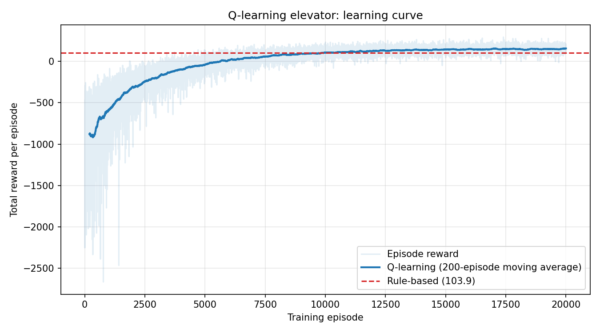

# Smart Elevator: Tabular Q-Learning

A beginner-friendly reinforcement learning project. A tabular Q-learning agent controls one elevator
in a 5-floor building, and its performance is compared with a random policy and a hand-written
rule-based policy on identical passenger arrivals.



## The environment (`elevator_env.py`, NumPy only)

- **Building:** 5 floors (numbered 0-4 in code; floor 0 is the lobby), 1 elevator, 200 steps per episode.
- **Actions:** `UP`, `DOWN`, `STAY` (STAY opens the doors: riders get off, waiting passengers get on).
- **State:** `(elevator floor, hall calls as 5 bits, cabin destinations as 5 bits, time-of-day bucket 0-3)`,
  encoded as one integer (20,480 states) for the Q-table.
- **Time of day** (each bucket is 50 steps):

  | Bucket | Period   | Arrival chance per step | Traffic pattern                      |
  |--------|----------|-------------------------|--------------------------------------|
  | 0      | Morning  | 30%                     | Mostly lobby to upper floors         |
  | 1      | Midday   | 20%                     | Random trips                         |
  | 2      | Evening  | 30%                     | Mostly upper floors to lobby         |
  | 3      | Off-peak | 5%                      | Random trips                         |

  In morning and evening, 80% of passengers follow the rush pattern and 20% travel randomly.
- **Rewards:** -1 per waiting passenger per step, -0.5 per move, +10 per passenger delivered,
  -2 for a useless STAY or hitting a wall.

## Files

| File | What it does |
|------|--------------|
| `elevator_env.py` | `ElevatorEnv`, `RandomPolicy`, `rule_based_policy`, `evaluate()`, `print_results_table()` |
| `q_learning_elevator.py` | Q-learning agent, training loop, CSV log, learning-curve plot, comparison table |
| `results/` | Learning curve and per-episode training log from the full run |

## Run it

```bash
pip install -r requirements.txt

python q_learning_elevator.py --test                 # quick check: 50 episodes, about a second
python q_learning_elevator.py --out results          # full run: 20,000 episodes, 1-3 minutes
```

In Google Colab, upload both `.py` files and use `!python q_learning_elevator.py --test`.

## Hyperparameters

`alpha = 0.1`, `gamma = 0.95`, epsilon decays 1.0 to 0.05 (exponentially, reaching 0.05 at 75% of
training), 20,000 training episodes. All random seeds are fixed, so results are reproducible.
Training uses its own arrival seed; evaluation uses seeds 0-99 for every policy, so the
comparison is fair.

## Results (greedy policy, 100 evaluation episodes)

```
Policy        Avg reward  Avg wait  Max wait  Total moves  Delivered
--------------------------------------------------------------------
Random            -916.0     25.07       188        10757       3500
Rule-based         103.9      4.11        39         9190       4256
Q-learning         159.5      4.50        54        14167       4244
```

The Q-learning agent earns the highest reward and delivers about as many passengers as the
rule-based policy, but it waits slightly longer and moves about 54% more. A likely reason is the
reward design: an idle STAY costs -2 while a move costs only -0.5, so the agent learns to keep moving
instead of waiting. Reducing the idle penalty or adding a longer-wait penalty are natural next experiments.

## Ideas for extending the project

- Change the reward so idle waiting is not punished more than moving.
- Penalize long individual waits, not just the number of people waiting.
- Add cabin capacity or multiple elevators.
- Train with several agent seeds and report the mean and spread.
